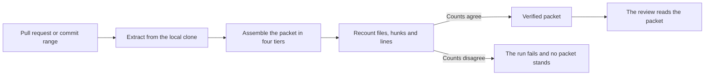

# Recognitio

[](https://github.com/david-engelmann/recognitio/actions/workflows/ci.yml)
[](LICENSE)
[](CHANGELOG.md)

Recognitio is an agent skill that pulls the relevant changes out of a pull request or a commit range and assembles them into a verified review packet. The packet holds the change plus the context a careful human reviewer would go and find, and it proves that nothing was left behind.

Recognitio serves the pull request review workflow. It is the step before the review itself, run when a reviewer must judge a change they did not write and needs the whole change on the page first.


In the paired eval recorded in this repo the packet pass found 8 of 8 planted defects across four fixture tasks and the raw diff pass found 4 of 8. Every defect the raw pass missed lived in a file the diff never showed. The full record lives in [the paired eval results](evals/RESULTS.md).

## What it does

- Pulls the change out of a pull request, a commit range or a single commit from the local clone
- Gathers the call sites, imports, definitions and test files that belong with the change
- Adds the history of the most changed files, with blame and earlier pull requests
- Counts every file, hunk and line twice by separate git invocations and calls the packet verified only when both counts agree

## See it on a real change

Commit `991ac6a` in this repo changed two gate scripts. The raw diff for `scripts/check_devin.py` shows a six line window around the edit, with three lines of context on each side.

```diff
diff --git a/scripts/check_devin.py b/scripts/check_devin.py
index 0327324..522392d 100644
--- a/scripts/check_devin.py
+++ b/scripts/check_devin.py
@@ -497,6 +497,15 @@ def semantic_problems(root=None):
             r"\b(" + MEMBERSHIP_PHRASES + r")\b.{0,15}\bresolved\b",
             low,
         ))
+        # Modifier chain from R36-E1-02. A membership phrase
+        # followed by a pure modifier chain and then
+        # resolved states the same membership at any gap
+        # length, so it fires beside the bounded form.
+        membership_modifier_chain = bool(re.search(
+            r"\b(" + MEMBERSHIP_PHRASES + r")\b"
+            + MEMBERSHIP_MODIFIER_GAP + r"resolved\b",
+            low,
+        ))
         # Verb plus membership from S4. A listed verb within
```

The packet for the same commit shows the change inside its whole enclosing function. The function runs 163 lines at the base revision and the packet carries all of it.

```text
### scripts/check_devin.py

Status: modified

diff --git a/scripts/check_devin.py b/scripts/check_devin.py
index 0327324..522392d 100644
--- a/scripts/check_devin.py
+++ b/scripts/check_devin.py
@@ -421,163 +421,173 @@ def naming_problems(root=None):
 def semantic_problems(root=None):
```

The same packet names the test files that mention the changed code and closes with the recount.

```text
### Test files that mention the changed code

#### tests/test_antigravity.py

47:         self.mod = load_script("check_antigravity")

#### tests/test_devin.py

20: at scripts/check_devin.py. These tests prove the pin fires
50:         self.mod = load_script("check_devin")

No tier was dropped.

Completeness check passed. A separate recount of files, statuses, old paths, hunks and lines matches the manifest.
```

Both excerpts are trimmed for length. The full packet for this commit runs 579 lines, and the commands that produce one for any change are in the Usage section below.

## How it works

Extraction runs on the local clone and assembles the packet in four tiers. A separate recount of the files, hunks and lines then decides whether the packet may call itself verified, and a disagreement fails the run and leaves no packet standing.



The tier model section below states what each tier holds, and the completeness guarantee section states what the recount proves.

## Why

A diff alone is not what a reviewer reads. A reviewer reads the change inside its enclosing function, follows changed names to the places that call them, opens the tests that touch the changed module, and checks who shaped these lines in the past. Most tools hand the reviewer a fixed slice of lines and stay silent when the slice runs out. Hosted diff endpoints cap their file counts and drop oversized patches without a flag, so a large pull request can be reviewed in part while everyone believes it was reviewed in whole.

Recognitio takes the other path. Extraction runs against the local clone, where there is no file count cap and the full history is present. The result is counted twice by separate git invocations, and the packet is only called verified when both counts agree.

## Install

Take one install route only. Installing through two routes installs the skill twice.

The plugin route comes first. Register this repo as a marketplace in Claude Code and install the recognitio plugin the listing offers. The marketplace entry sets strict to true, so the plugin manifest under `.claude-plugin/` is the definition the host loads and the listing and the manifest may both name the skill without conflicting.

```bash
/plugin marketplace add david-engelmann/recognitio
/plugin install recognitio@recognitio-marketplace
```

The Cursor plugin route loads the same skill through the Cursor plugin host. The manifest lives under `.cursor-plugin/` and ships the skill as a real directory copy, because the host skips a symlink that points outside the local plugin folder. The plugin is distributed through the manually reviewed Cursor Marketplace, and reviewed updates auto deploy to clients pinned at the commit SHA. For a local load test, copy the folder into the local plugin folder and reload the window, then confirm every component in Customize.

```bash
cp -r .cursor-plugin ~/.cursor/plugins/local/recognitio
```

The generic route works with any agent that reads the skill format.

```bash
npx skills add david-engelmann/recognitio
```

The folder copy route still works by hand. Copy the skill folder into any skills directory your agent reads.

```bash
cp -r .agents/skills/recognitio ~/.claude/skills/recognitio
```

### Qwen Code

The Qwen Code route is a conditional draft. The brief
at docs/qwen-code-brief.md states the full Qwen
contract, and the conditional publication decision
stays with David. No Qwen listing file ships in this
round.

```bash
git clone https://github.com/david-engelmann/recognitio.git recognitio-qwen
git -C recognitio-qwen checkout COMMIT_SHA
qwen extensions install ./recognitio-qwen/agent-plugins-package
```

Pin the Qwen route before use by cloning at a commit
SHA you reviewed, as the commands above show.
Replace COMMIT_SHA with the commit SHA you reviewed.
The marketplace source add stays a conditional draft
form in the brief only.

The scoped npm form below is an unpinned test form in
shape only. No scoped recognitio package is published
in this round and the scoped npm route is untested.

```bash
qwen extensions install @scope/my-extension@1.2.0
```

Before running any route above, pin the install to a commit
SHA and read the install script, because a skill ships
executable code and an unpinned route can move under you.

A copied or installed skill does not inherit later upstream
fixes. Receiving a fix means reinstalling or recopying from
a newly reviewed pinned commit.

Pinned forms. The plugin route pins on the marketplace add
line, with a commit SHA after a hash mark. The Cursor route
and the folder copy route pin by copying from a checkout at
a commit SHA. The generic route takes no ref, so its pinned
form is the folder copy from a checkout at a commit SHA.
Replace COMMIT_SHA with the commit SHA you reviewed.

```bash
/plugin marketplace add david-engelmann/recognitio#COMMIT_SHA
/plugin install recognitio@recognitio-marketplace
git clone https://github.com/david-engelmann/recognitio.git recognitio-pinned
git -C recognitio-pinned checkout COMMIT_SHA
cp -r recognitio-pinned/.cursor-plugin ~/.cursor/plugins/local/recognitio
cp -r recognitio-pinned/.agents/skills/recognitio ~/.claude/skills/recognitio
```

The extractor needs Python 3.10 or newer and git, and pull request mode also needs the GitHub CLI. There are no third party dependencies.

### The packet output style

The plugin ships an output style that shapes the review packet as the tiered section document the extractor writes. The style sets `force-for-plugin`, so it applies to every response in the session while the plugin is enabled and it overrides the output style chosen in your own settings. It reaches the main conversation and the forked extraction run, because the skill runs its extraction in a fork and a fork inherits the session style. It does not reach other subagents, which run their own system prompt. If another enabled plugin forces its own style and loads first, that style wins and the review falls back to the prose packet, which enforces every guarantee unchanged. The style is a format only. Every enforcement claim stays on the shipped scripts and the skill workflow.

### The reviewer persona

The plugin ships a reviewer persona as a plugin agent. The agent file lives at `agents/reviewer.md`, the manifest declares it under the `agents` key, and the manifest `settings` key names it as the session agent, so the host runs the reviewer as the session's main thread. The persona changes how the session speaks and works, not which tools it may use. A user's own `agent` setting overrides the plugin default, which is host behavior and not a defect. The brief at `docs/reviewer-persona.md` states the host rules and the persona bounds in full.

## Platform adaptations

The packet discipline travels. Each adaptation below restates it in the surface its platform reads, and on every row the guidance advises while enforcement stays on the shipped scripts.

| Platform | What ships |
| --- | --- |
| Claude Code | The home platform plugin, carrying the canonical skill, the packet output style and the reviewer persona |
| Codex | A review rules package, written as derivation noted rules in `docs/codex-review-brief.md` |
| Cursor | A plugin under `.cursor-plugin/` with the skill as a real directory copy and one rule file, plus the Bugbot rules in `.cursor/` |
| Copilot | A Copilot SDK agent build, written as derivation noted rules in `docs/copilot-sdk-brief.md` |
| CodeRabbit | Review guidelines in `.coderabbit.yaml` at the repo root, with the derivation noted brief at `docs/coderabbit-review-brief.md` |
| Kimi | A managed plugin build, written as derivation noted rules and the plugin contract in `docs/kimi-plugin-brief.md` |
| ZCode | A native plugin with its manifest at `.zcode-plugin/plugin.json`, distributed through its in client plugin marketplace |
| Devin | A playbook and coordinator build, written as derivation noted rules in `docs/devin-playbook-brief.md` |
| Qwen | A conditional draft, with the brief at `docs/qwen-code-brief.md` and the install route in the Install section above |

A Trae adaptation ships nothing. The round 32 check found no Trae skill or plugin surface in the primary docs, so the build stands deferred and no Trae brief, gate script or manifest ships.

## Usage

Extract a pull request by number. The base and head are resolved with the GitHub CLI and the extraction itself runs on local git objects. Both refs must already live in the local clone. When either one is missing the run stops and says to fetch it, because guessing from a same named local branch would build a packet for the wrong change.

```bash
python3 .agents/skills/recognitio/scripts/extract.py --pr 123 --out packet --repo .
```

Extract a commit range. Both spellings work and both use merge base semantics, so the packet shows what the head proposes rather than drift from the base branch.

```bash
python3 .agents/skills/recognitio/scripts/extract.py --range main...feature --out packet --repo .
python3 .agents/skills/recognitio/scripts/extract.py --range main..feature --out packet --repo .
```

Extract a single commit against its parent.

```bash
python3 .agents/skills/recognitio/scripts/extract.py --commit HEAD --out packet --repo .
```

Re-review after new commits land. The since ref is a re-review input that rides along with any mode, and the packet gains a section with the new commits and a range diff against the previous series. Pass a findings file and the section also marks each prior finding addressed or unaddressed. The findings file holds one finding per line in the form `path:line: text`.

```bash
python3 .agents/skills/recognitio/scripts/extract.py --range main...feature --since OLDHEAD --findings findings.txt --out packet --repo .
```

Set a token budget on a large change. The budget is an approximate token count taken as characters divided by four, and the accounting covers the whole packet, header and notes and re-review section included.

```bash
python3 .agents/skills/recognitio/scripts/extract.py --range main...feature --budget 60000 --out packet --repo .
```

Choose tiers directly when a review only needs part of the packet. Triage and the change always stay in.

```bash
python3 .agents/skills/recognitio/scripts/extract.py --range main...feature --tiers 0-1 --out packet --repo .
```

A run that builds a packet writes two files into the output directory. The packet file is the reading document, and its title calls it the pericope for the change. The manifest file is the receipt, with the resolved refs, the command that produced it, the per file record, the tier accounting, the section headings the packet carries, and the verified flag. A run that fails, at argument checking or later, removes any earlier packet from the directory first and leaves a manifest whose verified flag is false, so a stale packet can never stand as the result of the latest run, as long as the run named an output directory.

The script at `scripts/check_packet.py` validates a packet directory before a review is stamped on it. It confirms the manifest is verified, that the head it records is still the head of the repository under review, and that the sections the manifest records are present and filled in the packet.

## The tier model

The packet is built in four tiers.

- T0 is triage, with the pull request title, body and spec references when the mode resolves them, the file list, the numstat summary, and the commit list for the range. A changed file whose name marks it as an instruction bearing file, such as an AGENTS.md or a SKILL.md at any depth, is flagged as an instruction file in that list, and its record in the manifest carries the same flag, so a reviewer can tell which changed files will steer the next agent that loads the tree.
- T1 is the change, with per file diffs that carry whole enclosing function context instead of a fixed line radius.
- T2 is the companions, with call sites of the changed function names elsewhere in the repo, the imports of each changed file, definitions of the changed names outside the changed files, and test files that mention the changed modules. Companions come from deterministic search only, each one is capped, and the packet says when a cap was hit.
- T3 is history, with a blame summary for the changed ranges in the most changed files, the recent evolution of up to three changed functions, and prior pull requests touching the most changed files when the GitHub CLI can name them. That lookup checks the three most changed files against the thirty most recent pull requests and shows at most five matches, and the packet states that window where it reports the results. When the CLI cannot name them, the tier says so.

Some files stand in the change as named placeholders rather than diffs. A binary file is named with its byte count. A file detected as generated or as a lockfile is named with its detection reason, and detection works from a list of known lockfile names, known generated suffixes, and the do not edit marker in a file header. The header marker withholds a diff only when it already stood at the base revision. A marker that arrives in the change itself is flagged in the packet header and the change is shown in full, because a file cannot exempt itself with words it just wrote. Every placeholder keeps its lines and hunks counted in the manifest, and the packet header lists each one with its reason. A text file that the tree marks binary through its attributes file is counted and shown as text instead, and the header names that too. A file that changed from binary content to text in the change itself is counted and shown as text as well, its receipt names the transition as the real reason, and the manifest records the transition on the file record.

A budget spends itself in tier order. T3 drops first and T2 drops second, and the manifest records every drop with its reason. The receipt reports tokens per tier, files per tier, and what was cut. Files per tier counts what each tier worked over. T0 and T1 count every changed file, T2 counts the changed source files it searched for companions, and T3 counts the capped subset of most changed files it drew history from. The change itself never drops and never truncates. When T0 and T1 alone exceed the budget, the run fails with a clear message instead of handing over a partial change dressed as a whole one.

## The completeness guarantee

After assembly, the extractor recounts the changed files, their statuses, their old paths, their hunks, and their added and deleted lines with separate git invocations and compares the recount against the manifest. A disagreement writes a manifest whose verified flag is false, prints the discrepancy, and exits nonzero. A packet that failed its check must never be reviewed as if it were whole. Silence about a missing file is the one failure this project exists to prevent.

Two guards stand in front of the recount. Every git invocation runs with its output format pinned, so configuration in the clone or in a global config file cannot reshape the diff, and path data moves through NUL delimited output, so names with spaces, quotes, or non ASCII characters survive end to end. Packet text preserves the bytes of the change, CRLF line endings included. A shallow clone is refused before any of this runs, because its truncated history cannot support the guarantee.

## Trust and limits

Extraction is local only. The extractor reads a local clone with git plus the pull request metadata the GitHub CLI returns, and it writes a packet and a manifest into the output directory the run names. Nothing in the skill points an agent at an untrusted network source, and the bundled code takes no third party dependencies. Install the skill only from a source you trust, because a skill ships executable code and this one is no exception.

A verified packet proves one thing. It proves the packet holds the whole change it names, counted twice with agreement. It does not prove the change is correct and it does not prove the change is safe, and a clean packet is never a verdict on the code. Run the packet check script against a packet directory before a review is stamped on it.

## The name

Recognitio is a Latin word for a formal re-examination of a matter with the record open. Roman law used it when a case was looked at again by someone charged with getting it right. A pull request review is the same act in modern dress, and the packet this skill builds is the record the examination runs on.
