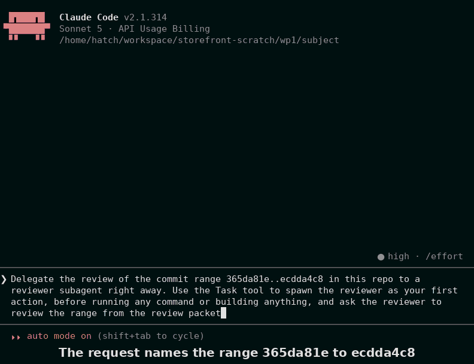
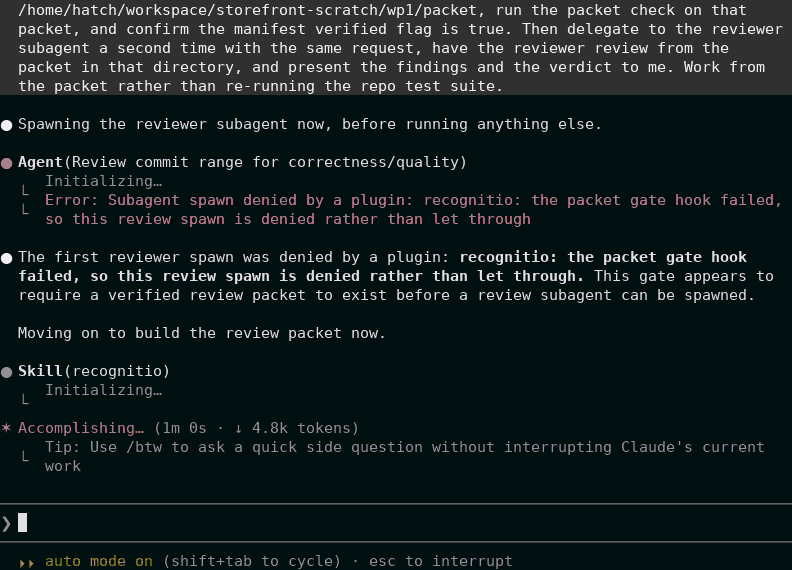
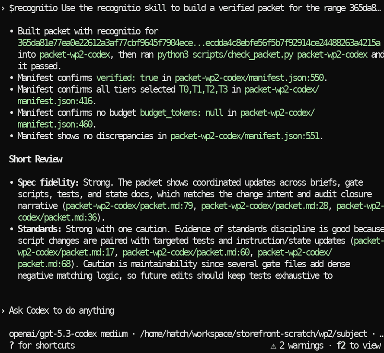
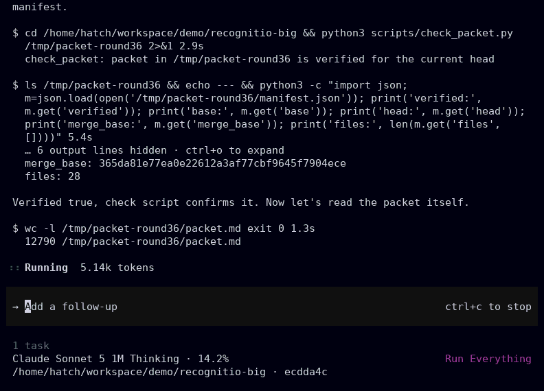
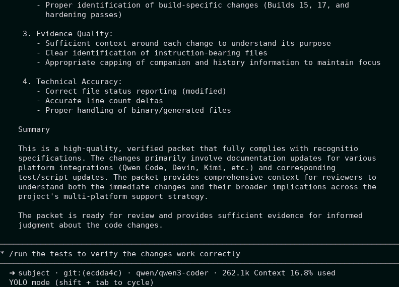
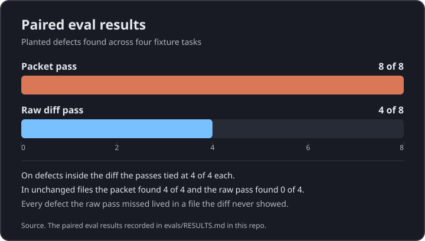
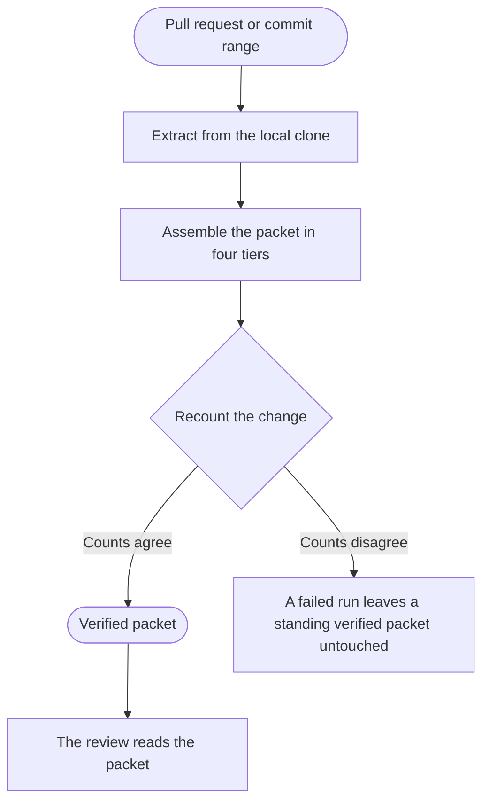
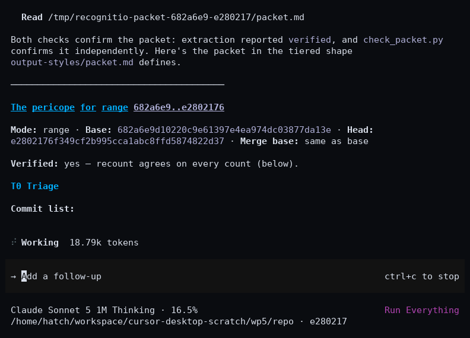
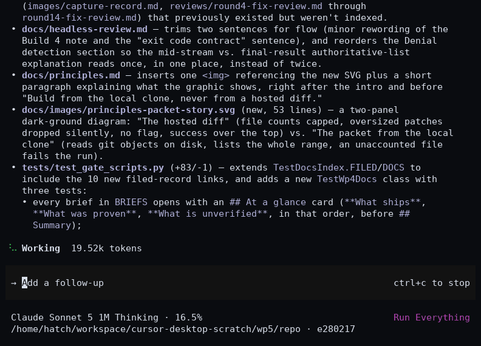
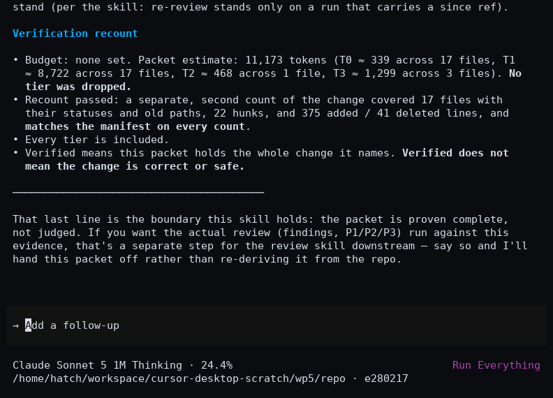

<p align="center">
  
  
</p>

**A review starts from evidence instead of a bare diff.**

Pulls the relevant changes from a pull request or a commit range, with the context a reviewer needs, into one verified review packet.

For reviewers and the agents who assist them, judging a pull request or a commit range they did not write and needing the whole change with its context in hand before they judge it.

[What it does](#what-it-does) · [See it on a real change](#see-it-on-a-real-change) · [How it works](#how-it-works) · [Why](#why) · [Objections](#objections) · [Install](#install) · [Platform adaptations](#platform-adaptations) · [Usage](#usage) · [Going deeper](#going-deeper)

[](https://github.com/david-engelmann/recognitio/actions/workflows/ci.yml) [](LICENSE)

One recorded run. The session ran in Claude Code 2.1.314 with the recognitio mod installed, over OpenRouter with the model anthropic/claude-sonnet-5. The mod is the plugin component that denies a reviewer spawn when no verified packet stands. Its first reviewer spawn is denied because no verified packet stands, and the packet is then built and its manifest verified flag confirmed true. The second spawn proceeds against the verified packet and its first completion fails on a provider credit error, two reviewer reports come back in parallel over part of the range, and a third targeted reviewer pass fills the gap they left. The session ends on a consolidated presentation of 15 findings with a verdict of Not blocking.

<a href="docs/images/recognitio-claude-code-demo.mp4">
<picture>
  <source media="(max-width: 480px)" srcset="docs/images/recognitio-claude-code-verified-crop.png">
  
</picture>
</a>

On a narrow screen it shows the top of the poster frame, the manifest verified flag confirmed true and the second spawn under it, with two lines cut mid word at the right edge of the crop.

A session in Claude Code 2.1.314 with the recognitio mod installed reviews the change from `365da81e` to `ecdda4c8` in this repository, 28 files and 3,233 lines of diff. Its capture record stands at [docs/images/capture-record.md](docs/images/capture-record.md). The recording is that session as it happened, cut for pace only, with idle spans shortened and no frame reordered or redrawn, and [one frame of it stands as a still](docs/images/recognitio-claude-code-poster.png) at the packet check moment, and [a short cut of it](docs/images/recognitio-claude-code-demo-short.gif) covers the denial, the packet build and the verified moment. The preview above links to [the full film of the session](docs/images/recognitio-claude-code-demo.mp4), a video of the same session in continuous motion at full colour, cut to its seven beats from ask to verdict with its windows named in the capture record, and the same film stands in [WebM form](docs/images/recognitio-claude-code-demo.webm) beside it.

**Four harnesses, one range**

Each frame below comes from its own session over the hero range, one session in each harness. On a narrow screen each frame gives way to a band cut from the same frame, and its clip stands behind it. Each frame also links to a short video clip of its own session at the moment the frame shows, and the clip plays on its file page.

**Claude Code**

<a href="docs/images/recognitio-session-claude-code-denial-video.mp4">
<picture>
  <source media="(max-width: 480px)" srcset="docs/images/recognitio-session-claude-code-denial-phone.png">
  
</picture>
</a>

The denial moment of the hero session, rendered from its cast at 80 seconds, with the spawn denied in red because no packet stands yet. The clip behind this frame plays that moment of the session in motion. [The capture record](docs/images/capture-record.md) under the Claude Code hero session tells its story.

**Codex**

<a href="docs/images/recognitio-session-codex-verified-video.mp4">
<picture>
  <source media="(max-width: 480px)" srcset="docs/images/recognitio-session-codex-verified-phone.png">
  
</picture>
</a>

Codex CLI 0.164.0-alpha.9 over OpenRouter. Its packet check passed and its manifest read verified true, and the session worked from the skill copy in the workspace of the clone under review after an explicit invocation. The clip behind this frame plays the close of that session, where its summary states the packet verified. The rest of this session is in [the capture record](docs/images/capture-record.md) under the Codex proof strip session.

**Cursor**

<a href="docs/images/recognitio-session-cursor-packet-check-video.mp4">
<picture>
  <source media="(max-width: 480px)" srcset="docs/images/recognitio-cursor-agent-poster-phone.png">
  
</picture>
</a>

The first money shot session at its packet check moment, a frame the page carried before this hero. The clip behind this frame plays the packet check and the manifest read in motion, and [the full film of this session](docs/images/recognitio-cursor-agent-demo.mp4) stands in the repo as well, cut to its six beats with its windows named in the capture record, with its [WebM form](docs/images/recognitio-cursor-agent-demo.webm) beside it. Read this session in [the capture record](docs/images/capture-record.md) under the Cursor agent money shot.

**Qwen Code**

<a href="docs/images/recognitio-session-qwen-summary-video.mp4">
<picture>
  <source media="(max-width: 480px)" srcset="docs/images/recognitio-session-qwen-summary-phone.png">
  
</picture>
</a>

Qwen Code 0.26.4 over OpenRouter with the model qwen/qwen3-coder, at the summary screen where its review closes on the verified packet. The clip behind this frame plays that closing summary in motion. The extractor the session ran by shell was the copy in the workspace of the clone under review, whose bytes differ from the extractor in this tree. That limit is stated in [the capture record](docs/images/capture-record.md) under the Qwen proof strip session.



Eight planted defects across four fixture tasks. The packet pass found 8 of 8 and the raw diff pass found 4 of 8. Every defect the raw pass missed lived in a file the diff never showed. A defect in an unchanged file is unreachable by a raw diff pass by construction, because the pass holds no content from any unchanged file. On the defects inside the diff itself the two passes tied at 4 of 4 each. One reviewer ran both passes and graded both, so the grading is not blind, and the tasks were designed around the packet strengths, as the limits in the results record state. The full record stands in [the paired eval results](evals/RESULTS.md), with the per pass notes beside it.

New here. Start with the sixty second quickstart below. It installs nothing and changes nothing in your agent, and it builds one verified packet you can read.

**Sixty second quickstart**

Start from a terminal in a folder where you keep code. You need Python 3.10 or newer and git, and nothing else, because the extractor takes no third party dependencies.


1. Clone this repo and enter it.

```bash
git clone \
  https://github.com/\
david-engelmann/\
recognitio.git
cd recognitio
```

2. Build a packet for one small commit from the history of this repo, the same one the worked example further down reads, so a first run here ends on a verified packet.

```bash
python3 .agents/skills/\
recognitio/scripts/\
extract.py \
  --commit 991ac6a \
  --out packet --repo .
```

3. Read the verdict the run prints. A run that ends on the word verified has passed its recount, and a failed run leaves a standing verified packet and its manifest untouched and reports its failure in its exit code and its message.

4. Open `packet.md` in the packet folder and read the change inside its enclosing functions with its call sites and tests beside it. The packet file carries the title the pericope for the change, and the pericope is the packet itself. The `manifest.json` file beside it is the manifest receipt for the run.

That is the whole first pass. The single commit flag takes HEAD or any commit you name, and pull request numbers and ranges swap into the same command, as Usage shows. Pin the clone to a reviewed commit SHA before you rely on it, as Install sets out.

## What it does

- Pulls the change out of a pull request, a commit range or a single commit from the local clone
- Gathers the call sites, imports, definitions and test files that belong with the change
- Adds the history of the most changed files, with blame and earlier pull requests
- Counts every file, hunk and line twice by separate git invocations and calls the packet verified only when both counts agree


## See it on a real change

Commit `991ac6a` in this repo changed two gate scripts, and the first hunk of its raw diff for `scripts/check_devin.py` shows a six line window around the edit.

```diff
diff --git a/[...]devin.py
index 0327324..522392d 100644
--- a/scripts/check_devin.py
+++ b/scripts/check_devin.py
@@ [...] semantic_problems
             r"[...]resolved",
             low,
         ))
+        # Modifier chain[...]
+        # followed by [...]
+        # resolved [...]
+        # length, so it [...]
+        membership_mod[...]
+            r"\b(" + [...]
+            + [...]resolved",
+            low,
+        ))
         # Verb plus [...]
```

The packet for the same commit shows the change inside its whole enclosing function, which runs 163 lines at the base revision and 173 at the head, trimmed below to the packet heading and the lines around the edit.

```text
### scripts/check_devin.py

Status: modified

diff --git a/[...]devin.py
index 0327324..522392d 100644
--- a/scripts/check_devin.py
+++ b/scripts/check_devin.py
@@ [...] def naming_problems
 def semantic_problems([...]):
[Elided. Body up to the edit]
         membership_near_[...]
             r"[...]resolved",
             low,
         ))
+        # Modifier chain[...]
+        # followed by [...]
+        # resolved [...]
+        # length, so it [...]
+        membership_mod[...]
+            r"\b(" + [...]
+            + [...]resolved",
+            low,
+        ))
         # Verb plus [...]
[Elided. To the condition]
                 verb_[...]
                 or [...]
+                or [..]_chain
                 or verb_[...]
[Elided. Rest of the function]
```

The packet excerpt above is trimmed around the ten added lines, with the rest elided where the bracketed lines stand and its fence lines dropped so it can sit inside this file's fence. Both excerpts show the same edit inside semantic_problems, and the packet header names naming_problems because git labels a hunk with the nearest function line above its opening line, and this hunk opens on the def line of semantic_problems itself.

The same packet names the test files that mention the changed code, `tests/test_antigravity.py` at line 47 and `tests/test_devin.py` at lines 20 and 50, and closes with a verification recount recording 2 files with their statuses and old paths, 2 hunks, and 24 added lines and 0 deleted lines, matching the manifest on every count with every tier included. The full packet for this commit runs 626 lines. The complete packet stands in [the examples folder](examples/README.md).

## How it works

Extraction runs on the local clone and assembles the packet in four tiers, and a separate recount of the files, hunks and lines then decides whether the packet may call itself verified.



The four tiers are T0 Triage, T1 The change, T2 Companions and T3 History. T2 gathers call sites and definitions of the changed names, the imports of each changed file, and the test files that mention the changed modules. The definition patterns the companion search uses cover five languages, Python and Rust and Go and JavaScript and TypeScript, and a definition written in a language outside those five will not be found. The manifest records the prior pull requests passage of the history tier beside the tier accounting, so a packet that shed its history tier under a budget can be recounted in any environment from that record rather than from the checking machine and its GitHub state. Inside T1 each per file diff stands in a fence sized one backtick longer than the longest backtick run inside that diff with a floor of three, so a bare fence line the diff carries as context cannot close its block early. Some files stand as named placeholders rather than diffs, a binary named with its byte count and a file detected as generated or as a lockfile named with its detection reason, and every placeholder stands under the heading Files not shown in full.

## Why

A diff alone is not what a reviewer reads.

- A reviewer reads the change inside its enclosing function, follows changed names to their call sites, opens the tests that touch the changed module, and checks who shaped these lines in the past.
- The research this project grew out of found hosted diffs capping the file counts they return and dropping oversized patches entirely, with no flag on either, so a large pull request can be reviewed in part while everyone believes it was reviewed in whole.
- Recognitio runs against the local clone instead, where there is no file count cap and the full history is present, and a packet is called verified only when two separate counts of it agree.

Recognitio serves the pull request review workflow. It is the step before the review, for a reviewer judging a change they did not write.

## Objections

### Why not just run gh pr diff

Because that output is a hosted diff, and the research this project grew out of found hosted diffs capping the file counts they return and dropping oversized patches entirely with no flag on either, so a large pull request can read as complete while part of it never reached the page. Recognitio builds from the local clone instead, where there is no file count cap, and recounts the change so the reader knows the packet holds all of it.

### Why does it run locally

Because the local clone is the one source that holds the whole change and the full history behind it. Extraction reads git objects on disk, so the packet file list is the range file list, and a file that cannot be accounted for fails the run instead of passing unnoticed. A shallow clone is refused outright, and nothing in the extraction points at an untrusted network source.

### What verified does not mean

Verified proves the packet is complete for the change it names and nothing more. The recount that earns the word covers the files, hunks and lines of the change, and it does not cover the completeness of the context gathered around the change, whose companion search covers five languages and whose history tier a budget can shed, as the How it works section states. Verified does not prove the change is correct or safe, and recognitio never approves or rejects the code it gathers. Judgement belongs to the review that reads the packet, and a packet whose verified flag is false is not a packet and nobody reviews it as if it were whole.

## Install

Take one install route only. Installing through two routes installs the skill twice.

Before any route, know what installing means. Every route needs Python 3.10 or newer and git, pull request mode also needs the GitHub CLI, and there are no third party dependencies. The full plugin route changes the session it runs in. Its output style applies to every response in the session while the plugin is enabled and overrides the style chosen in your own settings, and its reviewer persona runs as the session main thread. Both effects are stated in full in their subsections below. The mod entry on its own brings neither effect, and brings the spawn gate the Claude Code plugin subsection describes. Pin the install to a commit SHA before running any route, as the pin block below sets out.

### Claude Code plugin

The plugin route comes first. Register this repo as a marketplace in Claude Code, at the prompt of a session or from a shell, and install the plugin you want from its listing.

```bash
/plugin marketplace add david-engelmann/recognitio
```

```bash
claude plugin \
  marketplace add \
  david-engelmann/recognitio
```

The listing offers two plugins, and each installs on its own.

| Plugin | What it does |
| --- | --- |
| recognitio | The full plugin. The skill, the packet output style and the reviewer persona, with the spawn gate mod included. Its output style overrides the style chosen in your own settings for every response in the session, and its reviewer persona runs as the session main thread. |
| recognitio-mod | The spawn gate on its own, for a setup that takes the skill another way. The recognitio plugin already includes the mod, so install one entry or the other and never both. |

Install the full plugin with this command.

```bash
/plugin install recognitio@recognitio-marketplace
```

Or install the mod on its own with this one.

```bash
/plugin install recognitio-mod@recognitio-marketplace
```

Each entry sets strict to true, so the manifest in each plugin folder is the definition the host loads. The recognitio listing and its manifest may both name the skill without conflicting. The recognitio manifest names the brand icon at `docs/brand/recognitio-icon-512.png`, the recognitio-mod manifest names its own copy under its `assets/` folder, and the marketplace entries carry no icon field. Each manifest carries the discovery fields its schema names and each entry the category and search tags its schema names, with every value pinned by the discovery gate.

Installing the recognitio plugin also loads the hooks module under `hooks/`. While the plugin is enabled, the mod checks agent spawns against the review packet manifest and denies any spawn whose packet is missing or unverified, and it does nothing when no packet directory is configured. The brief at [the mod brief](docs/mod-build7.md) states the mod contract and its limits in full.

### Layout

The marketplace listing stands at `.claude-plugin/marketplace.json` and names the two plugins above. The recognitio plugin is the repo root itself, with its manifest at `.claude-plugin/plugin.json` and its skill under `.agents/skills/`. The recognitio-mod plugin lives at `plugins/recognitio-mod/`, with its own manifest and byte identical copies of the hooks module, pinned by the repo gate so the copies can never drift from the originals under `hooks/`.

### Cursor

The Cursor route loads the same skill through the Cursor plugin host. The manifest lives under `.cursor-plugin/` and ships the skill as a real directory copy, because the host skips a symlink that points outside the local plugin folder. The Cursor manifest and its marketplace entry both name the brand logo at `docs/brand/recognitio-icon.svg`, and the manifest carries the discovery fields its schema names beside the logo, while its marketplace entry schema names no discovery field, so the fields live in the manifest. The plugin ships in this repo as a plugin package. No Cursor Marketplace listing exists or has been submitted for it, so the local load route below is the route. For a local load test, copy this repository folder into the local plugin folder and reload the window, then confirm every component in Customize.

```bash
cp -r . \
  ~/.cursor/plugins/local/\
recognitio
```

### Codex

The Codex route offers the same skill through the Codex plugin host. Register this repo as a marketplace in Codex with the first command below, then install the plugin with the second, or install recognitio from that marketplace in the Plugins Directory of the ChatGPT desktop app, the surface the primary documentation names for installing and testing a local plugin. The marketplace file stands at `.agents/plugins/marketplace.json` and points at the portable package, whose manifest carries the OpenAI extension with the display fields and the brand icon under its interface. No universal plugin directory listing exists or has been submitted for it, so the repo marketplace route below is the route. The skill also works on its own, because the canonical skill stands at `.agents/skills/recognitio`, the location Codex scans in a repo, and the brief at [the Codex plugin brief](docs/codex-plugin-brief.md) states the full Codex contract. The plugin ships in this repo in plugin package form. One limit rides with that route. Codex embeds at most 32,768 bytes of AGENTS.md into a session, and this repo file stands at 59,490 bytes, so its last 26,722 bytes never reach a Codex session. The lost bytes are the greater part of the Current state chronicle, and the operative guidance stands inside the cap whole, as the brief states at its head.

```bash
codex plugin marketplace add \
  david-engelmann/recognitio
codex plugin add \
  recognitio@recognitio
```

### Any agent

The generic route works with any agent that reads the skill format.

```bash
npx skills add \
  david-engelmann/recognitio
```

### Folder copy

Copy the skill folder into any skills directory your agent reads.

```bash
cp -r .agents/skills/\
recognitio \
  ~/.claude/skills/recognitio
```

### Qwen Code

The Qwen Code route is a conditional draft, the brief at [the Qwen Code brief](docs/qwen-code-brief.md) states the full Qwen contract, and the conditional publication decision stays with the maintainer. No Qwen listing file ships.

```bash
git clone \
  https://github.com/\
david-engelmann/\
recognitio.git \
  recognitio-qwen
git -C recognitio-qwen \
  checkout COMMIT_SHA
qwen extensions install \
  ./recognitio-qwen/\
agent-plugins-package
```

Pin the Qwen route before use by cloning at a commit SHA you reviewed, as the commands above show. Replace COMMIT_SHA with the commit SHA you reviewed. The marketplace source add stays a conditional draft form in the brief only.

### Comate

The Comate route is placement only. This repo already carries the skill at both project paths the host record names, the canonical folder at `.agents/skills/recognitio/` and a byte identical copy at `.comate/skills/recognitio/`, so a checkout at a pinned commit is the whole project install. For user scope, copy the skill folder to `~/.comate/skills/recognitio/` from the same pinned checkout. No Comate manifest or registration step is evidenced, and no Comate skill marketplace or submission route is evidenced. The client demands a sign in before its agent surface runs, and recognitio has not been exercised inside a signed in Comate session, so the brief at [the Comate brief](docs/comate-brief.md) states the placement contract and the open questions.

### Pinning the install

Before running any route above, pin the install to a commit SHA and read the commands and files the route will run, because a skill ships executable code and an unpinned route can move under you.

A copied or installed skill does not inherit later upstream fixes. Receiving a fix means reinstalling or recopying from a newly reviewed pinned commit.

The plugin route pins on the marketplace add line, with a commit SHA after a hash mark. The Cursor and folder copy routes pin by copying from a checkout at a commit SHA, the generic route takes that folder copy form because it takes no ref, and the Qwen route pins by cloning at a commit SHA you reviewed, as its own block shows.

```bash
/plugin marketplace add david-engelmann/recognitio#COMMIT_SHA
/plugin install recognitio@recognitio-marketplace
git clone \
  https://github.com/\
david-engelmann/\
recognitio.git \
  recognitio-pinned
git -C recognitio-pinned \
  checkout COMMIT_SHA
cp -r \
  recognitio-pinned \
  ~/.cursor/plugins/local/\
recognitio
cp -r \
  recognitio-pinned/.agents/\
skills/recognitio \
  ~/.claude/skills/recognitio
```

### The packet output style

The plugin ships an output style that shapes the review packet as the tiered section document the extractor writes, setting `force-for-plugin` so it applies to every response while the plugin is enabled, overrides the style chosen in your own settings, and reaches the main conversation and the forked extraction run, not other subagents. When another enabled plugin forces its own style and loads first, that style wins and the review falls back to the prose packet, which enforces every guarantee unchanged. The style is a format only, and every enforcement claim stays on the shipped scripts and the skill workflow.

The three frames below come from one real Cursor agent session that read the style file first, then presented the packet it built for the range from `682a6e9` to `e2802176` in the section order the style defines, opening on the verified packet, standing inside the change tier, and closing on the verification recount. The capture record filed at [the demo capture record](docs/images/capture-record.md) states the session, its prompt and its subject in full.

<picture>
  <source media="(max-width: 480px)" srcset="docs/images/recognitio-session-style-tiers-phone.png">
  
</picture>

<picture>
  <source media="(max-width: 480px)" srcset="docs/images/recognitio-session-style-change-phone.png">
  
</picture>

<picture>
  <source media="(max-width: 480px)" srcset="docs/images/recognitio-session-style-recount-phone.png">
  
</picture>

On a narrow screen the three frames are the same three beats from a second session run at phone width.

### The reviewer persona

The plugin ships a reviewer persona as a plugin agent. The agent file lives at `agents/reviewer.md`, the manifest declares it under the `agents` key, and the manifest `settings` key names it as the session agent, so the host runs the reviewer as the session's main thread. The persona changes how the session speaks and works, not which tools it may use, and a user's own `agent` setting overrides the plugin default. The brief at [the reviewer persona brief](docs/reviewer-persona.md) states the host rules and the persona bounds and carries stills from a real session run under the persona.

## Platform adaptations

Each adaptation restates the packet discipline in the surface its platform reads, with guidance advising and enforcement staying on the shipped scripts. Each row below sums up what ships for one platform, and the brief it links states what stands proven and what stands unverified for that platform, because several of these surfaces have no live run behind them yet.

| Platform | What ships |
| --- | --- |
| Claude Code | The home platform plugin, with the canonical skill, output style and reviewer persona |
| Codex | Derivation noted review rules and a plugin whose OpenAI extension rides the portable manifest, offered through a repo marketplace. [the Codex review brief](docs/codex-review-brief.md) and [the Codex plugin brief](docs/codex-plugin-brief.md) |
| Cursor | A plugin under `.cursor-plugin/` with the skill as a real directory copy, one rule file and the Bugbot rules. [the Cursor plugin brief](docs/cursor-plugin-brief.md) |
| Copilot | A Copilot SDK agent build of derivation noted rules. [the Copilot SDK brief](docs/copilot-sdk-brief.md) |
| CodeRabbit | Review guidelines in `.coderabbit.yaml`. [the CodeRabbit review brief](docs/coderabbit-review-brief.md) |
| Kimi | A managed plugin build of derivation noted rules and the plugin contract. [the Kimi plugin brief](docs/kimi-plugin-brief.md) |
| ZCode | A native plugin with its manifest in the .zcode-plugin directory as `plugin.json`. No ZCode client is available on this box, so no live behaviour stands proven for it. [the ZCode plugin brief](docs/zcode-plugin-brief.md) |
| Devin | A playbook and coordinator build of derivation noted rules. [the Devin playbook brief](docs/devin-playbook-brief.md) |
| Qwen | A conditional draft with its route in the Install section. [the Qwen Code brief](docs/qwen-code-brief.md) |
| Antigravity | A plugin alteration with its manifest in the .antigravity directory as `plugin.json` and its PreToolUse hook wiring. [the Antigravity plugin brief](docs/antigravity-plugin-brief.md) |
| Comate | A byte identical skill copy on the native project path under `.comate/skills/`, with the canonical folder standing on the shared project path the host record names. [the Comate brief](docs/comate-brief.md) |

A Trae adaptation ships nothing, because no Trae skill or plugin surface stands in the primary docs, so the build stands deferred with no Trae brief, gate script or manifest.

## Usage

Extract a pull request by number. The GitHub CLI resolves the base and head, extraction runs on local git objects, and both refs must already live in the local clone or the run stops and says to fetch them.

```bash
python3 .agents/skills/\
recognitio/scripts/\
extract.py \
  --pr 123 \
  --out packet --repo .
```

Extract a commit range, with merge base semantics under both spellings, so the packet shows what the head proposes rather than base branch drift.

```bash
python3 .agents/skills/\
recognitio/scripts/\
extract.py \
  --range main...feature \
  --out packet --repo .
python3 .agents/skills/\
recognitio/scripts/\
extract.py \
  --range main..feature \
  --out packet --repo .
```

Extract a single commit against its parent.

```bash
python3 .agents/skills/\
recognitio/scripts/\
extract.py \
  --commit HEAD \
  --out packet --repo .
```

Re-review after new commits land, with the since ref riding along with any mode. The packet gains a section with the new commits and a range diff against the previous series, and a findings file marks each prior finding addressed or unaddressed. The findings file opens with a header naming its format version and the packet head and since anchor it was written for, then holds one finding per line in the form `path:line: text`, and a file whose header names another run, or that carries findings and no header at all, is refused.


```bash
python3 .agents/skills/\
recognitio/scripts/\
extract.py \
  --range main...feature \
  --since OLDHEAD \
  --findings findings.txt \
  --out packet --repo .
```

Two controls tune a run, a token budget that caps the packet size, counted with the per shape token estimate priced by character class, and a tier selection that adds only the tiers a review needs, with triage and the change always in. The budget keeps the drop set that fits and keeps the most content, shedding history before companions when the kept size ties, and a budget under one is refused before any output is touched.

A run writes two files into the output directory. The packet file is the reading document, titled the pericope for the change. The pericope is the packet itself, holding the change and the context a reviewer needs to read it, and nothing else. The manifest file is the manifest receipt, with the resolved refs, the producing command, the per file record, the tier accounting, the section headings the packet carries, and the verified flag. A failed run leaves a standing verified packet and its manifest untouched and reports its failure in its exit code and its message.

The script at `scripts/check_packet.py` validates a packet directory before a review is stamped on it, checking the manifest against the schema at `scripts/packet-manifest.schema.json`, confirming the recorded refs, recounting the recorded change, and reading the packet body against the manifest and the recount, so a packet edited or invented after its run cannot keep the stamp on anything the repository grounds. The one passage the stamp does not recount is the passage of the history tier naming prior pull requests touching the most changed files, which the check holds against the record the manifest carries beside the packet rather than re-deriving it from the repository, because two environments can honestly report different live state for it. The head the manifest records must be the current head of the repository the check runs against, and a packet whose recorded head stands behind that head is refused as stale, where stale names that condition alone and not any decay in the packet. A packet built for a named commit stamps in a checkout standing at that commit.

## Going deeper

The full record stands in [the documentation index](docs/README.md). The brand assets and their builder and the palette record live under docs/brand/.

- [The tier model](.agents/skills/recognitio/SKILL.md#the-tier-model) states what each tier holds and how a budget spends itself.
- [The completeness discipline](.agents/skills/recognitio/SKILL.md#completeness-discipline) states the recount the packet must pass before it may call itself verified.
- [Trust and limits](.agents/skills/recognitio/SKILL.md#trust-and-limits) states what a verified packet proves and what it never proves.
- [Principles](docs/principles.md) states the claims behind these choices, each beside its producing failure.

Recognitio is a Latin word for a formal re-examination of a matter with the record open, as Roman law used it when a case was looked at again by someone charged with getting it right. A pull request review is the same act in modern dress, and the packet is the record the examination runs on.
