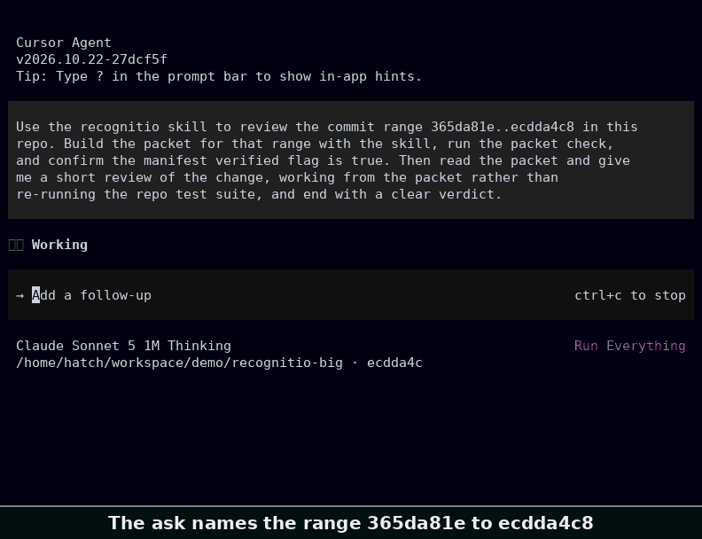
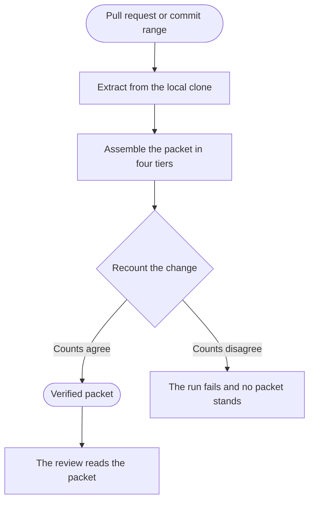

<p align="center">
  <picture>
    <source media="(prefers-color-scheme: dark)" srcset="docs/brand/wordmark-dark.svg">
    <source media="(prefers-color-scheme: light)" srcset="docs/brand/wordmark-light.svg">
    
  </picture>
</p>

**A review starts from evidence instead of a bare diff.**

Pulls the relevant changes from a pull request or a commit range, with the context a reviewer needs, into one verified review packet.

[What it does](#what-it-does) · [See it on a real change](#see-it-on-a-real-change) · [How it works](#how-it-works) · [Why](#why) · [Install](#install) · [Platform adaptations](#platform-adaptations) · [Usage](#usage) · [Going deeper](#going-deeper)

[](https://github.com/david-engelmann/recognitio/actions/workflows/ci.yml) [](LICENSE)

One recorded run in full. A session in the Cursor agent uses the recognitio skill to review the change from `365da81e` to `ecdda4c8` in this repository, 28 files and 3,233 lines of diff, and its capture record stands at `docs/images/capture-record.md`. The recording is that session as it happened, cut for pace only, with idle spans shortened and no frame reordered or redrawn, and [one frame of it stands as a still](docs/images/recognitio-cursor-agent-poster.png) at the moment the packet check passes.



In the paired eval recorded in this repo the packet pass found 8 of 8 planted defects across four fixture tasks and the raw diff pass found 4 of 8. Every defect the raw pass missed lived in a file the diff never showed. A defect in an unchanged file is unreachable by a raw diff pass by construction, because the pass holds no content from any unchanged file. On the defects inside the diff itself the two passes tied at 4 of 4 each. The full record lives in [the paired eval results](evals/RESULTS.md).

New here. Start with the [Install](#install) section below and take the plugin route first.

## What it does

- Pulls the change out of a pull request, a commit range or a single commit from the local clone
- Gathers the call sites, imports, definitions and test files that belong with the change
- Adds the history of the most changed files, with blame and earlier pull requests
- Counts every file, hunk and line twice by separate git invocations and calls the packet verified only when both counts agree

## See it on a real change

Commit `991ac6a` in this repo changed two gate scripts. The first hunk of the raw diff for `scripts/check_devin.py` shows a six line window around the edit, with three lines of context on each side.

```diff
diff --git a/scripts/check_devin.py b/scripts/check_devin.py
index 0327324..522392d 100644
--- a/scripts/check_devin.py
+++ b/scripts/check_devin.py
@@ -497,6 +497,15 @@ def semantic_problems(root=None):
             r"\b(" + MEMBERSHIP_PHRASES + r")\b.{0,15}\bresolved\b",
             low,
         ))
+        # Modifier chain from R36-E1-02. A membership phrase
+        # followed by a pure modifier chain and then
+        # resolved states the same membership at any gap
+        # length, so it fires beside the bounded form.
+        membership_modifier_chain = bool(re.search(
+            r"\b(" + MEMBERSHIP_PHRASES + r")\b"
+            + MEMBERSHIP_MODIFIER_GAP + r"resolved\b",
+            low,
+        ))
         # Verb plus membership from S4. A listed verb within
```

The packet for the same commit shows the change inside its whole enclosing function. The function runs 163 lines at the base revision and 173 at the head, and the excerpt below is trimmed to the packet heading and the lines around the edit.

```text
### scripts/check_devin.py

Status: modified

diff --git a/scripts/check_devin.py b/scripts/check_devin.py
index 0327324..522392d 100644
--- a/scripts/check_devin.py
+++ b/scripts/check_devin.py
@@ -421,163 +421,173 @@ def naming_problems(root=None):
 def semantic_problems(root=None):
[Elided. The body of the function up to the edit stands in the full packet]
         membership_near_resolved = bool(re.search(
             r"\b(" + MEMBERSHIP_PHRASES + r")\b.{0,15}\bresolved\b",
             low,
         ))
+        # Modifier chain from R36-E1-02. A membership phrase
+        # followed by a pure modifier chain and then
+        # resolved states the same membership at any gap
+        # length, so it fires beside the bounded form.
+        membership_modifier_chain = bool(re.search(
+            r"\b(" + MEMBERSHIP_PHRASES + r")\b"
+            + MEMBERSHIP_MODIFIER_GAP + r"resolved\b",
+            low,
+        ))
         # Verb plus membership from S4. A listed verb within
[Elided. The lines between this comment and the condition below stand in the full packet]
                 verb_then_equivalence
                 or membership_near_resolved
+                or membership_modifier_chain
                 or verb_then_membership_near_resolved
[Elided. The rest of the function stands in the full packet]
```

The packet excerpt above is trimmed, chosen around the ten added lines, and the rest of the function is elided where the bracketed lines stand. The fence lines inside the packet itself are dropped so the excerpt can sit inside the fence of this file. Both excerpts show the same edit inside semantic_problems, and the packet header names naming_problems because git labels a hunk with the nearest function line above its opening line, and this hunk opens on the def line of semantic_problems itself.

The same packet names the test files that mention the changed code, `tests/test_antigravity.py` at line 47 and `tests/test_devin.py` at lines 20 and 50, and closes with a verification recount. The recount records 2 files with their statuses and old paths, 2 hunks, and 24 added lines and 0 deleted lines, matches the manifest on every count, and passes with every tier included. The full packet for this commit runs 622 lines.

## How it works

Extraction runs on the local clone and assembles the packet in four tiers, and a separate recount of the files, hunks and lines then decides whether the packet may call itself verified.



The four tiers are T0 Triage, T1 The change, T2 Companions and T3 History. T2 gathers call sites and definitions of the changed names, the imports of each changed file, and the test files that mention the changed modules. The definition patterns the companion search uses cover five languages, Python and Rust and Go and JavaScript and TypeScript, and a definition written in a language outside those five will not be found.

Some files stand as named placeholders rather than diffs, a binary named with its byte count and a file detected as generated or as a lockfile named with its detection reason, and every placeholder stands in the packet under the heading Files not shown in full.

## Why

A diff alone is not what a reviewer reads.

- A reviewer reads the change inside its enclosing function, follows changed names to their call sites, opens the tests that touch the changed module, and checks who shaped these lines in the past.
- The research this project grew out of found hosted diffs capping the file counts they return and dropping oversized patches entirely, with no flag on either, so a large pull request can be reviewed in part while everyone believes it was reviewed in whole.
- Recognitio runs against the local clone instead, where there is no file count cap and the full history is present, and a packet is only called verified when two separate counts of it agree.

Recognitio serves the pull request review workflow. It is the step before the review itself, for a reviewer judging a change they did not write.

## Install

Take one install route only. Installing through two routes installs the skill twice.

Before any route, know what installing means. Every route needs Python 3.10 or newer and git, pull request mode also needs the GitHub CLI, and there are no third party dependencies. The plugin route changes the session it runs in. Its output style applies to every response in the session while the plugin is enabled and overrides the style chosen in your own settings, and its reviewer persona runs as the session main thread. Both effects are stated in full in their subsections below. Pin the install to a commit SHA before running any route, as the pin block below sets out.

### Claude Code plugin

The plugin route comes first. Register this repo as a marketplace in Claude Code and install the recognitio plugin the listing offers. The marketplace entry sets strict to true, so the plugin manifest under `.claude-plugin/` is the definition the host loads and the listing and the manifest may both name the skill without conflicting. The manifest names the brand icon at `docs/brand/recognitio-icon-512.png` for the directory listing, and the marketplace entry carries no icon field.

```bash
/plugin marketplace add david-engelmann/recognitio
/plugin install recognitio@recognitio-marketplace
```

### Cursor

The Cursor route loads the same skill through the Cursor plugin host. The manifest lives under `.cursor-plugin/` and ships the skill as a real directory copy, because the host skips a symlink that points outside the local plugin folder. The Cursor manifest and its marketplace entry both name the brand logo at `docs/brand/recognitio-icon.svg`, and the brand assets and their builder and palette record live under `docs/brand/`. The plugin ships in this repo as a plugin package. No Cursor Marketplace listing exists or has been submitted for it, so the local load route below is the route. For a local load test, copy the folder into the local plugin folder and reload the window, then confirm every component in Customize.

```bash
cp -r .cursor-plugin ~/.cursor/plugins/local/recognitio
```

### Any agent

The generic route works with any agent that reads the skill format.

```bash
npx skills add david-engelmann/recognitio
```

### Folder copy

Copy the skill folder into any skills directory your agent reads.

```bash
cp -r .agents/skills/recognitio ~/.claude/skills/recognitio
```

### Qwen Code

The Qwen Code route is a conditional draft. The brief at [the Qwen Code brief](docs/qwen-code-brief.md) states the full Qwen contract, and the conditional publication decision stays with the maintainer. No Qwen listing file ships.

```bash
git clone https://github.com/david-engelmann/recognitio.git recognitio-qwen
git -C recognitio-qwen checkout COMMIT_SHA
qwen extensions install ./recognitio-qwen/agent-plugins-package
```

Pin the Qwen route before use by cloning at a commit SHA you reviewed, as the commands above show. Replace COMMIT_SHA with the commit SHA you reviewed. The marketplace source add stays a conditional draft form in the brief only.

### Pinning the install

Before running any route above, pin the install to a commit SHA and read the commands and files the route will run, because a skill ships executable code and an unpinned route can move under you.

A copied or installed skill does not inherit later upstream fixes. Receiving a fix means reinstalling or recopying from a newly reviewed pinned commit.

The plugin route pins on the marketplace add line, with a commit SHA after a hash mark. The Cursor route and the folder copy route pin by copying from a checkout at a commit SHA, the generic route takes that folder copy form because it takes no ref, and the Qwen route pins by cloning at a commit SHA you reviewed, as its own block shows.

```bash
/plugin marketplace add david-engelmann/recognitio#COMMIT_SHA
/plugin install recognitio@recognitio-marketplace
git clone https://github.com/david-engelmann/recognitio.git recognitio-pinned
git -C recognitio-pinned checkout COMMIT_SHA
cp -r recognitio-pinned/.cursor-plugin ~/.cursor/plugins/local/recognitio
cp -r recognitio-pinned/.agents/skills/recognitio ~/.claude/skills/recognitio
```

### The packet output style

The plugin ships an output style that shapes the review packet as the tiered section document the extractor writes. It sets `force-for-plugin`, so it applies to every response in the session while the plugin is enabled, overrides the style chosen in your own settings, and reaches the main conversation and the forked extraction run, not other subagents. When another enabled plugin forces its own style and loads first, that style wins and the review falls back to the prose packet, which enforces every guarantee unchanged. The style is a format only. Every enforcement claim stays on the shipped scripts and the skill workflow.

### The reviewer persona

The plugin ships a reviewer persona as a plugin agent. The agent file lives at `agents/reviewer.md`, the manifest declares it under the `agents` key, and the manifest `settings` key names it as the session agent, so the host runs the reviewer as the session's main thread. The persona changes how the session speaks and works, not which tools it may use, and a user's own `agent` setting overrides the plugin default. The brief at [the reviewer persona brief](docs/reviewer-persona.md) states the host rules and the persona bounds in full.

## Platform adaptations

Each adaptation restates the packet discipline in the surface its platform reads, and on every row the guidance advises while enforcement stays on the shipped scripts.

| Platform | What ships |
| --- | --- |
| Claude Code | The home platform plugin, with the canonical skill, output style and reviewer persona |
| Codex | Derivation noted review rules. [the Codex review brief](docs/codex-review-brief.md) |
| Cursor | A plugin under `.cursor-plugin/` with the skill as a real directory copy, one rule file and the Bugbot rules. [the Cursor plugin brief](docs/cursor-plugin-brief.md) |
| Copilot | A Copilot SDK agent build of derivation noted rules. [the Copilot SDK brief](docs/copilot-sdk-brief.md) |
| CodeRabbit | Review guidelines in `.coderabbit.yaml`. [the CodeRabbit review brief](docs/coderabbit-review-brief.md) |
| Kimi | A managed plugin build of derivation noted rules and the plugin contract. [the Kimi plugin brief](docs/kimi-plugin-brief.md) |
| ZCode | A native plugin with its manifest at `.zcode-plugin/plugin.json`, distributed through its in client plugin marketplace. [the ZCode plugin brief](docs/zcode-plugin-brief.md) |
| Devin | A playbook and coordinator build of derivation noted rules. [the Devin playbook brief](docs/devin-playbook-brief.md) |
| Qwen | A conditional draft with its route in the Install section. [the Qwen Code brief](docs/qwen-code-brief.md) |
| Antigravity | A plugin alteration with its manifest at `.antigravity/plugin.json` and its PreToolUse hook wiring. [the Antigravity plugin brief](docs/antigravity-plugin-brief.md) |

A Trae adaptation ships nothing. No Trae skill or plugin surface stands in the primary docs, so the build stands deferred and no Trae brief, gate script or manifest ships.

## Usage

Extract a pull request by number. The GitHub CLI resolves the base and head, the extraction runs on local git objects, and both refs must already live in the local clone or the run stops and says to fetch them.

```bash
python3 .agents/skills/recognitio/scripts/extract.py \
  --pr 123 --out packet --repo .
```

Extract a commit range, with merge base semantics under both spellings, so the packet shows what the head proposes rather than drift from the base branch.

```bash
python3 .agents/skills/recognitio/scripts/extract.py \
  --range main...feature --out packet --repo .
python3 .agents/skills/recognitio/scripts/extract.py \
  --range main..feature --out packet --repo .
```

Extract a single commit against its parent.

```bash
python3 .agents/skills/recognitio/scripts/extract.py \
  --commit HEAD --out packet --repo .
```

Re-review after new commits land, with the since ref riding along with any mode. The packet gains a section with the new commits and a range diff against the previous series, and a findings file marks each prior finding addressed or unaddressed, one per line in the form `path:line: text`.

```bash
python3 .agents/skills/recognitio/scripts/extract.py \
  --range main...feature --since OLDHEAD \
  --findings findings.txt --out packet --repo .
```

Two controls tune a run, a token budget that caps the packet size, counted as characters divided by four, and a tier selection that adds only the tiers a review needs, with triage and the change always in.

A run writes two files into the output directory. The packet file is the reading document, and its title calls it the pericope for the change. The pericope is the packet itself, holding the change and the context a reviewer needs to read it, and nothing else. The manifest file is the receipt, with the resolved refs, the command that produced it, the per file record, the tier accounting, the section headings the packet carries, and the verified flag. A failed run removes any earlier packet first and leaves that flag false, so a stale packet can never stand as the latest result. The script at `scripts/check_packet.py` validates a packet directory before a review is stamped on it, confirming the manifest is verified, that the head it records is still the head of the repository under review, and that the recorded sections are present and filled in the packet.

## Going deeper

The full record stands in the docs, starting with [the documentation index](docs/README.md).

- [The tier model](.agents/skills/recognitio/SKILL.md#the-tier-model) states what each tier holds and how a budget spends itself across them.
- [The completeness discipline](.agents/skills/recognitio/SKILL.md#completeness-discipline) states the recount the packet must pass before it may call itself verified.
- [Trust and limits](.agents/skills/recognitio/SKILL.md#trust-and-limits) states what a verified packet proves and what it never proves.
- [Principles](docs/principles.md) states the claims behind these choices, each one beside the failure that produced it.

Recognitio is a Latin word for a formal re-examination of a matter with the record open. Roman law used it when a case was looked at again by someone charged with getting it right. A pull request review is the same act in modern dress, and the packet is the record the examination runs on.
