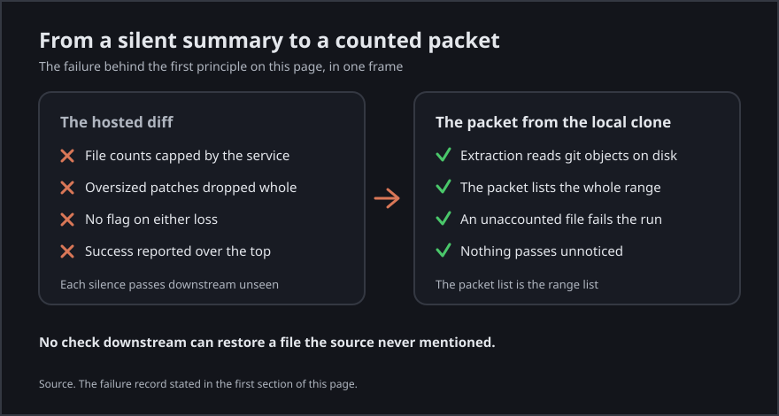

[Back to the documentation index](README.md)

# Principles

What a review packet owes its reader, stated as claims. Every claim on
this page answers a failure in this project record, and the failure
stands beside the claim that came out of it.

The graphic above tells the first failure on this page in one
frame. A hosted diff can drop content with no flag on the loss,
while a packet built from the local clone must account for
every file in the range or fail the run. The prose below it
stays the record the graphic draws from, and the graphic
carries its own dark ground so it reads the same on a light
page and on a dark one.

## Build from the local clone, never from a hosted diff

A hosted diff is a summary written by a service with limits of its own.
The research this project grew out of found hosted diffs capping the
file counts they return and dropping oversized patches entirely, with no
flag on either and a success response over the top. A packet built from
that summary inherits each silence in it, and no check downstream can
restore a file the source never mentioned.

The local clone holds the whole change. Extraction reads git objects on
disk, so the file list in the packet is the file list in the range, and
a file that cannot be accounted for fails the run instead of passing
unnoticed.

## Fail closed, every time

A packet carries a verified flag, and a packet whose flag is false is
not a packet. Nobody reviews it as if it were whole, nobody stamps a
report on it, and the run that produced it exits nonzero with the
disagreement printed.

The flag alone is not enough, because a manifest can claim more than the
packet holds. Late in this record a thin packet could wear a full packet
manifest. The manifest recorded a tier as included while the packet body
carried only the placeholder for a tier that was not gathered, and the
stamp accepted the pair.

The checker now reads the tier receipt against the packet bodies, so a
tier the manifest records as included cannot stand in the packet as only
that placeholder.

## Pin every input that could reshape the change

Git will happily reshape its own output. In the first hardening cycle a
file named café.py was mangled and dropped under the default
core.quotepath setting while the packet reported verified true, because
the path data both readings relied on had been rewritten by
configuration before either one saw it. The bytes were never the
problem. The unpinned input was.

Object identity is an input too. In the second cycle a git replace ref
swapped the head object for a benign one while the manifest recorded the
real head SHA and verified true, and assembly and recount agreed
perfectly about the wrong tree. Every invocation now runs with its
output format pinned and replace objects refused, so configuration in
the clone and refs in its object store cannot quietly rewrite the change
under review.

## The recount must measure the same change as the manifest

Verification that counts a different thing from the thing it checks
proves nothing in either direction. The extractor counts lines from
numstat for the manifest and recounts them from a zero context diff, and
for most of this record those two channels agreed.

On real commits late in the record they stopped agreeing, because one
channel had been given a diff algorithm the other did not use, and the
two algorithms pair the repeated lines of a dense file differently and
return different totals in either direction. On one real commit the
manifest counted 106 added and 54 deleted lines while the recount
counted 108 and 56.

The manifest counts matched git show exactly. The recount was counting a
different edit script, so honest packets on real history failed
verification. A check that cries wolf on true packets is broken even
when it fails safe, because it teaches reviewers to route around the one
gate that exists to stop them.

## Carry the context as part of the change

A hunk shows the lines that changed and a few lines around them. It does
not show the function the change lives in, the call sites that depend on
it, or the tests that name it, and a reviewer judging from the hunk
alone is guessing at everything the hunk touches. The packet therefore
carries the whole enclosing function for every change it shows as a
diff, and the companions that belong with it.

The paired eval recorded in this repo measured what judging from the
diff alone costs. The packet pass found 8 of 8 planted defects across
four fixture tasks and the raw diff pass found 4 of 8, and every defect
the raw pass missed lived in a file the diff never showed. A reviewer
cannot find a defect in a file the evidence never carried.

## Cut everything before you cut the change

A real change in this record ran 3,233 lines over 28 files. Read raw, it
floods the session and the review degrades into skimming. The packet
answers with tiers. Triage and the change itself always stand, and
history and companions are what a budget drops, in that order, with the
drop recorded where the reader can see it.

The budget has its own failure in this record. In the first hardening
cycle, whole sections of the packet were emitted without being counted
against it, and packets ran two to three times over the budget they
reported as respected. The accounting now covers every section the
packet carries.

What a budget may never do is reach the change itself, and when triage
and the change alone exceed it, the run fails instead of handing over a
partial change dressed as a whole one.
