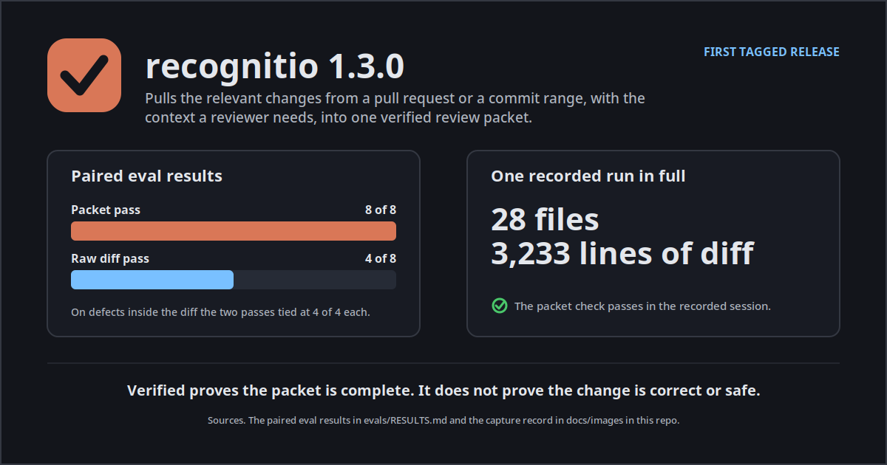

[Back to the documentation index](README.md)

# Recognitio 1.3.0 release draft

This file is a draft prepared for the first tagged release of recognitio. No tag has been cut and no release has been published. The tag is cut by David Engelmann alone and the ordered steps for cutting it stand in the tag checklist at the foot of this file.

## What recognitio is

Pulls the relevant changes from a pull request or a commit range, with the context a reviewer needs, into one verified review packet.

Recognitio is for reviewers and the agents who assist them, judging a pull request or a commit range they did not write and needing the whole change with its context in hand before they judge it. A review starts from evidence instead of a bare diff.

## What it does

- Pulls the change out of a pull request, a commit range or a single commit from the local clone
- Gathers the call sites, imports, definitions and test files that belong with the change
- Adds the history of the most changed files, with blame and earlier pull requests
- Counts every file, hunk and line twice by separate git invocations and calls the packet verified only when both counts agree

Extraction runs on the local clone and assembles the packet in four tiers. The tiers are T0 Triage, T1 The change, T2 Companions and T3 History. A separate recount of the files, hunks and lines then decides whether the packet may call itself verified, and the packet closes with a verification recount receipt.

## What this release carries

This is the first tagged release, so everything the tree carries ships in it at once.

- The recognitio skill and its extractor, which build the packet from local git only and stamp a manifest that fails closed when its recount disagrees
- The packet check script, which validates a packet directory before a review is stamped on it
- Plugin packaging for Claude Code, with a plugin manifest and a marketplace listing that name the skill by its explicit path
- A reviewer persona that runs as the session main thread and a packet output style that shapes how a packet reads
- Platform adaptations that restate the packet discipline for Codex, Cursor, Copilot, CodeRabbit, Kimi, ZCode, Devin and Antigravity, plus a conditional draft for Qwen Code
- An eval layer with paired fixture tasks, a trigger set for the skill description and a corpus index that maps audit incidents to the tests that cover them
- A complete worked packet in the examples folder, which a visitor can open whole without installing anything

## The highlights graphic



The graphic above is built from material this repo already stands behind. Its bars restate the paired eval result, its figures restate the one recorded run, and its closing line restates the limit on what verified means. It carries its own dark ground from the brand palette, so it reads the same on a light page and on a dark page, and its master stands beside the export at `docs/images/release-1.3.0-highlights.svg`.

## How to install it

Take one install route only, because installing through two routes installs the skill twice. Every route needs Python 3.10 or newer and git, pull request mode also needs the GitHub CLI, and there are no third party dependencies. Pin the install to a commit SHA you reviewed before you rely on it for real review work.

The plugin route comes first for Claude Code. Register this repo as a marketplace and install the plugin the listing offers.

```bash
/plugin marketplace add david-engelmann/recognitio
/plugin install recognitio@recognitio-marketplace
```

The other routes stand in the Install section of the README. A Cursor route loads the same skill through the Cursor plugin host from a local copy, a generic route works with any agent that reads the skill format, and a folder copy route places the skill folder in any skills directory your agent reads. The Qwen Code route is a conditional draft and no Qwen listing file ships.

A copied or installed skill does not inherit later upstream fixes. Receiving a fix means reinstalling or recopying from a newly reviewed pinned commit.

## The proof it stands on

Eight planted defects across four fixture tasks. The packet pass found 8 of 8 and the raw diff pass found 4 of 8. Every defect the raw pass missed lived in a file the diff never showed. A defect in an unchanged file is unreachable by a raw diff pass by construction, because the pass holds no content from any unchanged file. On the defects inside the diff itself the two passes tied at 4 of 4 each. The full record stands in [the paired eval results](../evals/RESULTS.md) and the per pass notes stand beside it.

One recorded run stands in full on the README. A session in the Cursor agent uses the recognitio skill to review a change of 28 files and 3,233 lines of diff in this repository, and its capture record stands at `docs/images/capture-record.md`. The recording is that session as it happened, cut for pace only, and one frame of it stands as a still at the moment the packet check passes.

One complete packet stands open in [the examples folder](../examples/README.md). It covers a commit that changed two gate scripts, its recount records 2 files, 2 hunks and 24 added lines and 0 deleted lines, and the full packet runs 622 lines with a manifest that records verified as true.

## Its proven limits

- Verified proves the packet is complete and nothing more. It does not prove the change is correct or safe, and recognitio never approves or rejects the code it gathers. Judgement belongs to the review that reads the packet.
- A packet whose verified flag is false is not a packet, and nobody reviews it as if it were whole.
- The definition patterns the companion search uses cover five languages, Python and Rust and Go and JavaScript and TypeScript, and a definition written in a language outside those five will not be found.
- Some files stand as named placeholders rather than diffs. A binary file is named with its byte count and a file detected as generated or as a lockfile is named with its detection reason, and every placeholder stands in the packet header and is counted in full in the manifest.
- A shallow clone is refused outright, because the local clone is the one source that holds the whole change and the full history behind it.
- No Cursor Marketplace listing exists or has been submitted, so the local load route is the Cursor route. The Qwen Code route stays a conditional draft whose publication decision stays with the maintainer.
- The briefs record named runtime items for Qwen and Kimi and Cursor as unverified, and this release claims nothing for them. Each one stands in its brief in its current wording.

## Where to read more

- [Principles](principles.md) states the claims a review packet owes its reader, each one paired with the failure in this project record that produced it.
- [The documentation index](README.md) groups every brief and record in the docs set with a one line summary for each one.
- [The README](../README.md) carries the worked example, the usage spellings and the full install routes.

## Tag checklist

This checklist is the exact ordered path from this draft to a published release. David performs every step himself. Nothing in this file cuts a tag, creates a release or changes a repository setting.

### Preconditions already verified

- The release base is commit `81814e371ccfd400a86ebaccaadd89940afe00e4` on `main`, and its tree is `1dfa3c4b7ad041eae02b3a4efa5cf76347c1a41d`.
- The full local gate passed on that head with 886 tests. This draft landing changes no extractor code and no version surface, and its own gate result stands in the lane report that shipped it.
- Version coherence stands at 1.3.0 on every surface that carries a version, re-verified file by file before this draft was written. The gate script at `scripts/check_version.py` reports that version 1.3.0 agrees across the plugin manifest, the marketplace listing, the extractor and the changelog.
- The Claude plugin manifest at `.claude-plugin/plugin.json` carries version 1.3.0.
- The Claude marketplace listing at `.claude-plugin/marketplace.json` carries version 1.3.0 in its metadata and version 1.3.0 on its plugin entry.
- The Cursor plugin manifest at `.cursor-plugin/plugin.json` carries version 1.3.0.
- The Cursor marketplace listing at `.cursor-plugin/marketplace.json` carries version 1.3.0 in its metadata and version 1.3.0 on its plugin entry.
- The portable package manifest at `agent-plugins-package/plugin.json` carries version 1.3.0.
- The ZCode plugin manifest at `.zcode-plugin/plugin.json` carries version 1.3.0.
- The Antigravity plugin manifest at `.antigravity/plugin.json` carries version 1.3.0.
- The extractor at `.agents/skills/recognitio/scripts/extract.py` carries `EXTRACTOR_VERSION` at 1.3.0, and the two skill copies pinned byte identical to it carry the same value.
- The changelog records its unreleased work as carrying version 1.3.0, and the proof run manifest at `workflows/proof-run/manifest.json` records version 1.3.0.
- No tag and no release exists on the repository yet, checked against the live repository before this draft was written.
- The social preview asset stands in the tree at `docs/brand/recognitio-social-preview.png` at 1280 by 640 pixels, ready for the upload step below.
- The highlights graphic stands in the tree at `docs/images/release-1.3.0-highlights.png` with its master at `docs/images/release-1.3.0-highlights.svg`, ready for the attach step below.

### The prepared topics

The topics step below replaces the repository topics with these 17 topics. The list keeps the eight topics the repository already carries and adds the platform names the adaptations table ships.

1. `agent-skills`
2. `ai-agents`
3. `claude-code`
4. `code-review`
5. `diff`
6. `git`
7. `pull-request`
8. `python`
9. `codex`
10. `cursor`
11. `github-copilot`
12. `coderabbit`
13. `devin`
14. `qwen`
15. `kimi`
16. `zcode`
17. `antigravity`

### Step 1. Confirm the base still stands

Surface is your local clone of this repository in a terminal. Fetch the remote, check out commit `81814e371ccfd400a86ebaccaadd89940afe00e4` and run the full gate with `make check`. Expected result is a green gate on that exact commit. If the gate fails, stop here and cut nothing.

### Step 2. Cut the tag on the named head

Surface is the same local clone, still on the named commit from step 1. Create an annotated tag named `v1.3.0` on that commit and read it back with the rev parse command for the tag. Expected result is that the tag resolves to commit `81814e371ccfd400a86ebaccaadd89940afe00e4` and to no other commit. The tag names the verified code head, and this draft landing on `main` after that head changes no code the tag certifies.

### Step 3. Push the tag

Surface is the same terminal, pushing to the GitHub remote. Push the single tag `v1.3.0`. Expected result is that the repository tags page lists `v1.3.0` and shows it pointing at the named commit.

### Step 4. Apply the prepared topics

Surface is the repository home page on GitHub, in the About panel at the top right of the page, through its gear control. Replace the topic list with the 17 prepared topics recorded above, in full. Expected result is that the About panel shows all 17 topics and the eight old topics stand inside the new list rather than beside it.

### Step 5. Upload the social preview

Surface is the repository Settings page on GitHub, in the social preview area of the general settings. Upload the file at `docs/brand/recognitio-social-preview.png` from a checkout of this repository. Expected result is that the settings page shows that image as the social preview, so a shared link to the repository renders with the recognitio card instead of a generated default.

### Step 6. Create the release from this draft

Surface is the Releases page of the repository on GitHub, through its new release control. Choose the existing tag `v1.3.0`, set the release title to recognitio 1.3.0, and paste the body of this draft as the release notes, starting at the What recognitio is heading and ending at the close of the Where to read more section. Expected result is a saved draft release that targets `v1.3.0` and reads as the notes above, with the draft status wording and this checklist left behind in this file.

### Step 7. Attach the highlights graphic

Surface is the same draft release on GitHub, in its attachment area. Attach the file at `docs/images/release-1.3.0-highlights.png` from a checkout of `main`. Expected result is that the graphic appears on the release as an attached file and renders at the foot of the notes, and its master stays in the tree at `docs/images/release-1.3.0-highlights.svg` for anyone who wants the source.

### Step 8. Publish the release

Surface is the same draft release on GitHub, through its publish control. Publish the release. Expected result is that the Releases page lists recognitio 1.3.0 as the latest release, built on tag `v1.3.0`.

### Step 9. Read the shipped surfaces once

Surface is the live repository on GitHub in a browser. Open the repository home page, the release page and one shared link preview. Expected result is that the About panel shows the 17 topics, the release page shows the notes and the highlights graphic, and the shared link renders with the uploaded social preview. Any surface that disagrees is a defect to fix forward, and the tag itself does not move.
