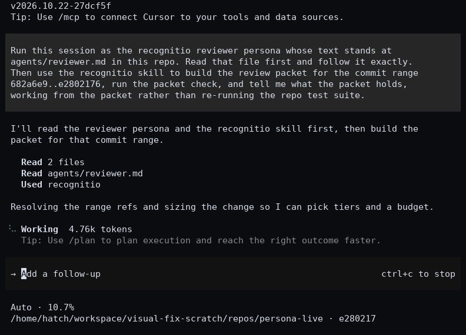
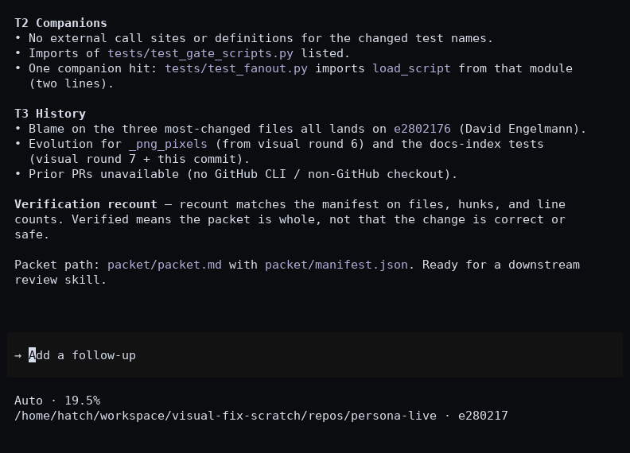
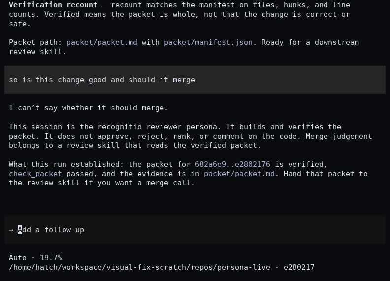

[Back to the documentation index](README.md)

# The reviewer persona, Build 5

Build 5 puts a plugin agent in the session's main thread. The
plugin ships an agent file at `agents/reviewer.md`, declares
it under the `agents` key of the plugin manifest, and names it
as the session agent under the manifest `settings` key. The
host reads the `agent` key and answers in the main conversation
with the reviewer's system prompt and model. The primary
source for every rule below is the plugin components page at
https://code.claude.com/docs/en/plugins/components, read on
2026-10-23.

## What the host does

The precedence rules in this section are host behavior, not
recognitio promises. The host owns them, and the gate pins
the shape that invokes them rather than re-proving them.

The `agent` key runs one of the plugin's own agents as the
session's main thread. The session answers with that agent's
system prompt and model. Only `agent` and
`subagentStatusLine` take effect in plugin settings, and
every other key is dropped at load. The same object may ship
as `settings.json` at the plugin root or inline under the
manifest `settings` key. This plugin ships the manifest key
only. When both shapes exist, the file wins and the manifest
key is ignored.

A user's own `agent` setting overrides the plugin default.
When two enabled plugins set the same key, the plugin loaded
last wins. A forced output style follows its own rule, which
the README already records. A forced plugin style overrides
the output style chosen in the user's own settings, and when
several enabled plugins force a style, the first loaded wins.
The two keys must not be confused. The `agent` key and the
forced style flag resolve in opposite directions across
plugins, and the plan once stated them backwards, which the
round 16 red team caught.

## What the persona does

The persona changes the persona and not the tool access. The
tool access of the agent is the session's tool set, which the
`agent` key does not grant or widen. The agent file declares
no `tools` allowlist and no `permissionMode`, and the gate
forbids both as defense in depth. The host supports a
`tools` field on plugin agents in general, so the ban is a
recognitio bound and not a host limit. The persona carries
no instruction the canonical skill text does not carry,
apart from the pinned persona prose the gate checks word
for word.

## The agent file's frontmatter control panel

In this document the frontmatter control panel means the
bounded frontmatter fields of the agent file. The Build 1
skill frontmatter panel is the separate panel decision 9
records, and the two must not be confused. The round 16
external lane flagged the shared term, and this section is
the disambiguation it asked for.

The host honors `model`, `effort`, `maxTurns`,
`disallowedTools`, and `isolation` on a plugin agent, and
`worktree` is the only valid `isolation` value. It ignores
`permissionMode`, `hooks`, `mcpServers`, and `initialPrompt`
on a plugin agent, and an agent file cannot add hooks or MCP
servers on its own. The shipped agent file sets the name and
the description only. The gate pins every field above by
shape and fails any other field, so a persona can arrive or
widen only through a gate failure.

## The persona in a session

The three frames below come from one real Cursor agent
session that was asked to run as this persona. The session
read the agent file first, built the packet for the range
from `682a6e9` to `e2802176` with the skill, ran the packet
check, and reported what the packet holds. A follow up then
asked whether the change is good and whether it should
merge, and the session refused the judgement in the
persona's own terms and named the review skill downstream
as its owner. The capture record filed at
[the demo capture record](images/capture-record.md) states
the session and its prompts and its subject in full.

The persona is a Claude Code plugin agent, and no Claude
Code session runs on the box these frames were captured on.
The session therefore ran on the Cursor agent surface with
the persona text read from the shipped agent file, and the
frames show the persona's words at work in a session and
claim nothing about the Claude Code host behaviour the
sections above describe.

<picture>
  <source media="(max-width: 480px)" srcset="images/recognitio-session-persona-opening-phone.png">
  
</picture>

<picture>
  <source media="(max-width: 480px)" srcset="images/recognitio-session-persona-packet-phone.png">
  
</picture>

<picture>
  <source media="(max-width: 480px)" srcset="images/recognitio-session-persona-refusal-phone.png">
  
</picture>

On a narrow screen the three frames are the same
three beats from a second session run at phone
width over the same range.

## Limits

The persona enforces nothing. Decision 4 binds this build
like every other build, and every enforcement claim stays on
the shipped scripts and the skill workflow steps.

The persona brief leaves `disable-model-invocation` at its
default false and withholds the skill through no deny rule,
so scheduled runs through `/loop` keep working. Setting the
flag true would turn scheduled fires into plain text sends,
which is the failure mode the primary scheduled tasks page
warns about.

The description protocol is untouched. No Build 5 file
touches the skill description or the canonical skill text,
so the trigger protocol does not fire.

A user settings file that names another agent overrides
this persona, by the host rule above. That is a user choice
and not a defect. A second plugin that sets the `agent` key
resolves by the loaded last rule above, which the host logs.
