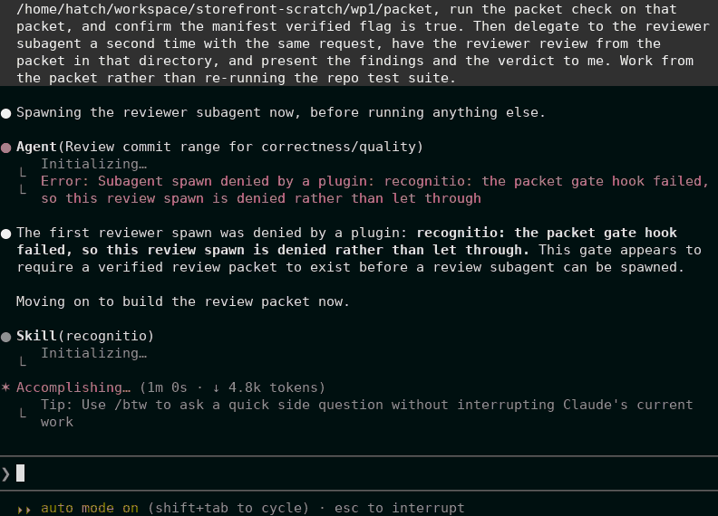

# Recognitio Mod

The spawn gate from the recognitio review workflow, packaged as a
plugin on its own.

The mod registers one hook on the agent spawn event in Claude Code.
When a reviewer or any other agent is about to start inside a
session, the hook reads the review packet manifest named by the
RECOGNITIO_PACKET_DIR environment variable. A packet whose manifest
reads verified lets the spawn through. A packet whose manifest is
missing, unreadable, unparsable or not verified denies the spawn
with a reason. When no packet directory is configured, the mod is
inert and every spawn passes through, because the mod enforces the
review workflow and is not a global spawn gate.

A hook crash fails closed. The registration carries a catch
handler that returns the deny shape, so a crashed hook denies the
spawn rather than letting it through. If the catch handler itself
throws or times out, the host skips the hook as if it had no
handler and the spawn proceeds. That second layer fail open is a
stated limit of the build, and the full contract stands in the
brief at [docs/mod-build7.md](../../docs/mod-build7.md).

The contract the repo gate certifies is the shipped module and
the modules standing in its structural family. A module carrying
a construct outside that family is refused by the gate rather
than judged, and the brief names the seven residual shapes that
stand outside what a structural gate can judge.

The main recognitio plugin already includes this mod, because the
hooks folder at the repo root loads with that plugin. This entry
exists for a setup that wants the spawn gate without the skill
bundle, such as a folder copy install of the skill. Install one
shape or the other, and never both, because installing both
registers the same gate twice.

The mod needs Claude Code v2.1.287 or later, the first build
with mods, and stands live tested on 2.1.314, where it
validates clean and gates spawns in headless and streamed
sessions and on the marketplace install route. The filmed
hero session below ran on that same build with the mod
installed from this tree by the marketplace route.

In that filmed Claude Code session, the one shown as the
hero recording on the main page, the first reviewer spawn
is denied because the packet directory stands created and
empty. The agent then builds the packet, runs the packet
check and confirms the manifest verified flag is true. The
second spawn proceeds against the verified packet and its
first completion fails on a provider credit error, two
reviewer reports come back in parallel over part of the
range, and a third targeted reviewer pass fills the gap
they left, and the session ends on a consolidated
presentation of 15 findings with a verdict of Not blocking. The
frame below is the denial moment of that session, rendered from
its cast at 80 cast seconds and palette quantized to 32 colours,
with the session record in the capture record under docs/images
in the main repo.



```bash
/plugin marketplace add david-engelmann/recognitio
/plugin install recognitio-mod@recognitio-marketplace
```

The files under hooks in this folder are byte identical copies of
the module in the hooks folder at the repo root, and the repo gate
pins the copies to the original so the two can never drift apart.

## License

MIT
